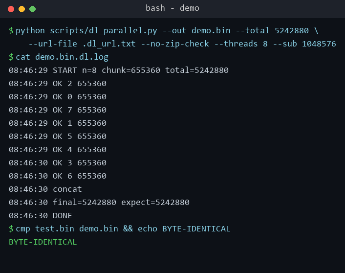

# github-fast-download

加速 GitHub 大文件（尤其是 release 资产）下载的 **WorkBuddy 技能**。

当下载慢到单线程要 10 小时、你喊着「像迅雷一样多线程 / 多源加速」时，这个技能先**诊断文件到底有几个真实来源**，再选对打法，而不是盲目开线程。

## 目录

- [快速开始](#快速开始)
- [它能解决什么](#它能解决什么)
- [核心结论（踩坑实测）](#核心结论踩坑实测)
- [安装（作为 WorkBuddy 技能）](#安装作为-workbuddy-技能)
- [用法](#用法)
- [真实运行示例](#真实运行示例)
- [本机实测陷阱（必读）](#本机实测陷阱必读)
- [许可证](#许可证)
- [贡献](#贡献)

## 快速开始

三步跑起来：

1. **装技能**：把仓库克隆到用户级技能目录
   ```bash
   git clone https://github.com/hulufeng/github-fast-download.git \
     ~/.workbuddy/skills/github-fast-download
   ```
2. **拿直链**：只要有 release 下载页 URL 即可，脚本会自动解析签名直链（无需手动复制那串长 URL）。
3. **开下**：
   ```bash
   python scripts/dl_parallel.py --out FILE.zip --total <字节数> \
       --release-url https://github.com/OWNER/REPO/releases/download/TAG/ASSET
   ```
   下载完会打印 `final=<n> expect=<n>` 与 `ZIP_OK`（zip 完整性校验通过）。遇到更慢的单源文件，把 `--threads` 调大到 64（默认）即可。

## 它能解决什么

- 你拿到一个 `release-assets.githubusercontent.com/...` 签名直链，下载龟速。
- 你抱怨下载慢，提到迅雷 / 多线程 / 多源 / 开源下载方案。
- 你想要一份可复用的「慢速下载对抗方法论」。

## 核心结论（踩坑实测）

GitHub release 资产通常是**单源**文件：所有 ghproxy 等镜像最终都 302 回同一个 Azure blob。**所以「迅雷式多源聚合」在这里根本不成立**——只能走**单源多连接**。

- 单连接被限速 ≈ 15 KB/s；开 64 条连接线性聚合到 ≈ 600 KB/s ~ 1.1 MB/s。
- 单源 → `scripts/dl_parallel.py`（Python 64 线程分片 + 1MB 小包断点续写 + 实时读直链抗 token 过期）。
- 真多源（多个独立 URL）→ `aria2c -x 16 -s 16 -k 1M -Z url1 url2 url3`。

完整决策树与陷阱清单见 [`references/strategy-and-pitfalls.md`](references/strategy-and-pitfalls.md)。

## 安装（作为 WorkBuddy 技能）

```bash
# 方式一：git 克隆到用户级技能目录
git clone https://github.com/hulufeng/github-fast-download.git \
  ~/.workbuddy/skills/github-fast-download

# 方式二：下载 zip 解压到 ~/.workbuddy/skills/github-fast-download/
```

重启 / 刷新 WorkBuddy 后，遇到慢速下载会自动触发本技能。

## 用法

### 单源（最常见）

```bash
# 已知直链，直接下载
python scripts/dl_parallel.py --out FILE.zip --total <字节数> --url-file .dl_url.txt

# 只有 release 下载页 URL，自动解析签名直链
python scripts/dl_parallel.py --out FILE.zip --total <字节数> \
    --release-url https://github.com/OWNER/REPO/releases/download/TAG/ASSET

# 后台刷新直链（防下载中途 token 过期）
python scripts/refresh_token.py --release-url <页URL> --url-file .dl_url.txt --interval 540 &
```

下载完成会输出 `final=<n> expect=<n>` 与 `ZIP_OK`（zip 完整性校验通过）。

### 真多源

```bash
aria2c -x 16 -s 16 -k 1M -Z "url1" "url2" "url3"
```

## 真实运行示例

下图是一次**真实运行**的终端截图（为便于离线复现，本地起了一个支持 HTTP Range 的服务器来模拟「单源」；实际使用时把 `--url-file` 换成 GitHub release 签名直链即可，逻辑完全相同）——8 线程并行分片、拼接、大小校验全部走完，且 `cmp` 证实与源文件**字节级一致**：



## 本机实测陷阱（必读）

1. **Git Bash / Cygwin fork 上限 ~30** 后台子进程 → 用 Python `threading`，别开几十个 `curl &`。
2. **aria2 `--max-connection-per-server` 上限 1–16**，`-x 32` 被拒。
3. **aria2 Windows 版不支持 `--range`**（报 unknown option）。
4. **ghproxy 中继掉速 / 中断** → 只用来解析直链，绝不用来传大文件。
5. **单连接限速 ~15 KB/s** → 并行分片是唯一解。
6. **签名直链 token 过期** → 后台 `refresh_token.py` 续命。

## 许可证

**CC BY-NC 4.0（署名—非商业性使用 4.0 国际）**。

- ✅ 允许：个人学习、研究、非商业项目中使用、修改、分发本技能，须保留署名。
- ❌ 禁止：任何商业用途（包括但不限于将本技能或其派生作品用于盈利性产品 / 服务、商业培训等），未经版权人书面许可不得商用。

完整法律文本见 [LICENSE](LICENSE)；人类可读摘要见 <https://creativecommons.org/licenses/by-nc/4.0/>。

## 贡献

欢迎参与改进，详见 [CONTRIBUTING.md](CONTRIBUTING.md)。
